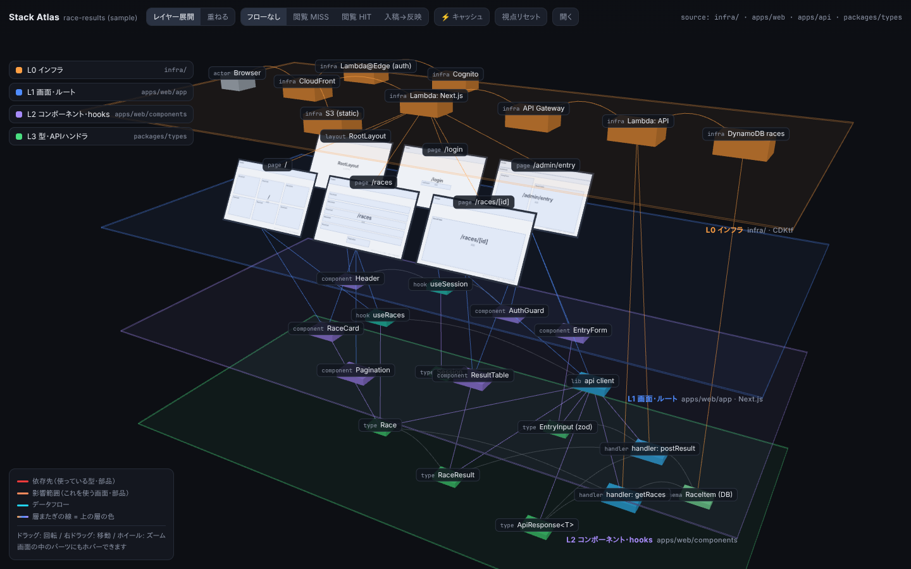
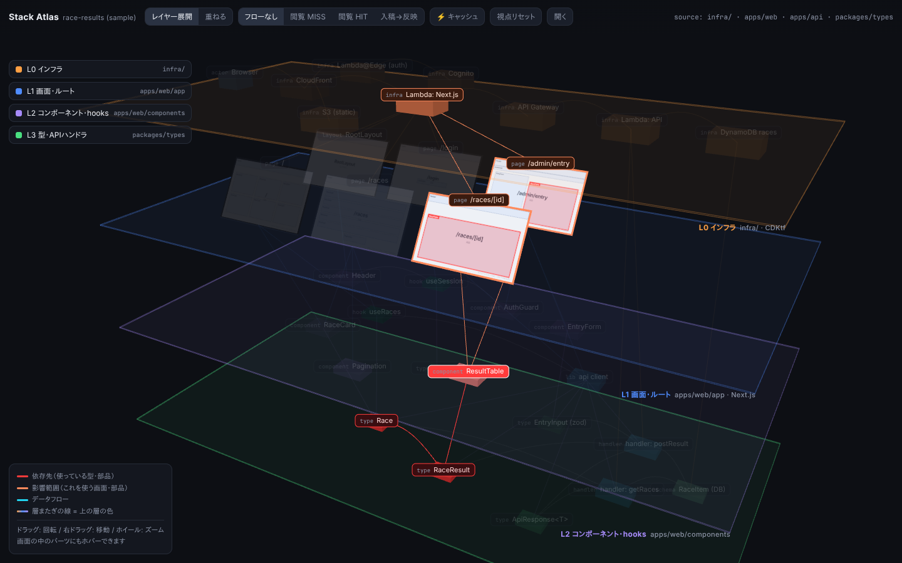
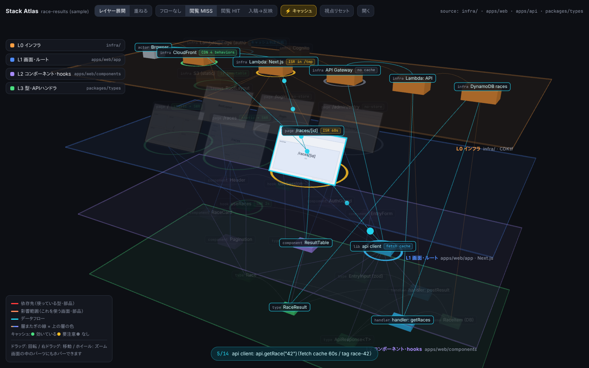
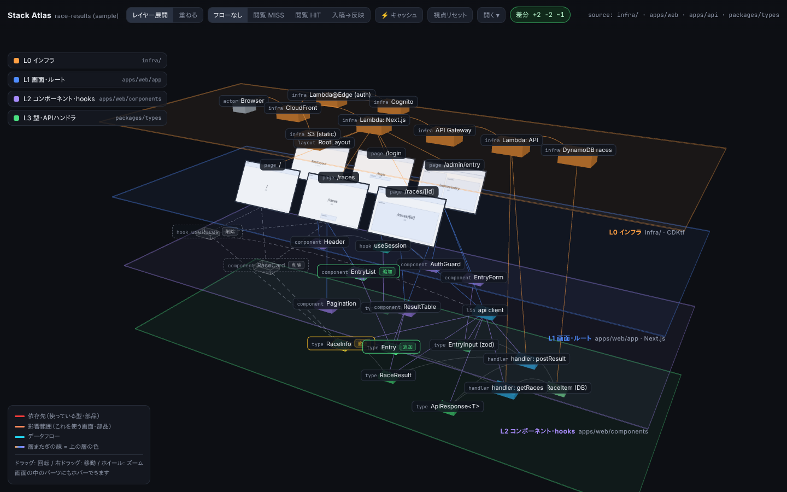
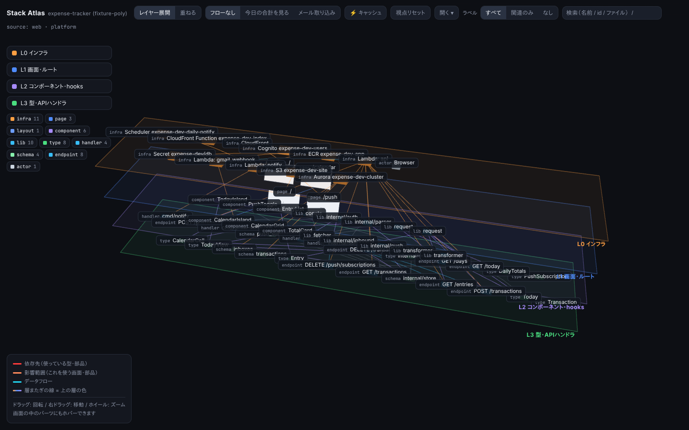
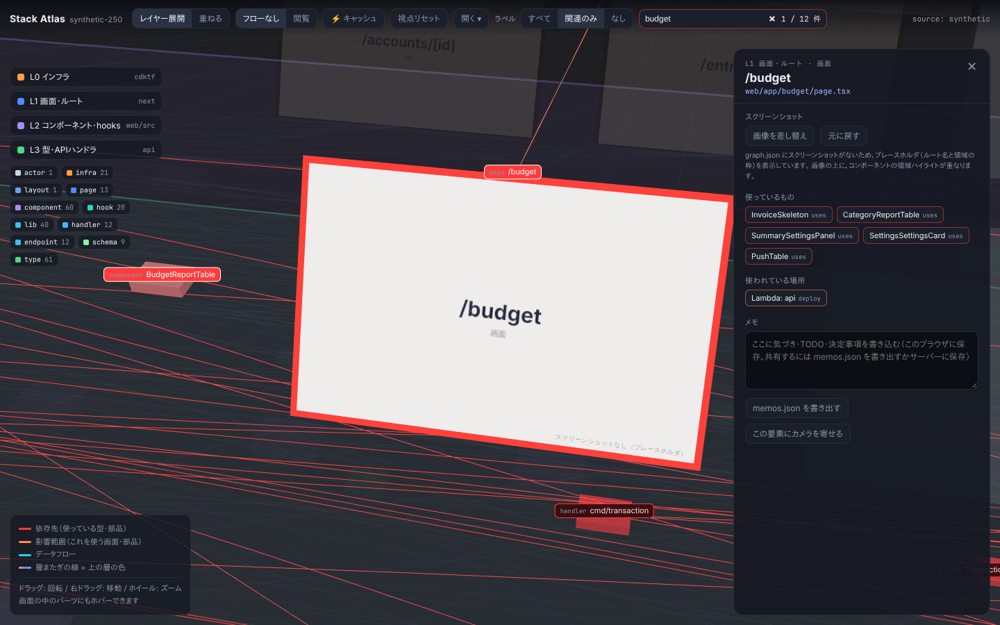

# Stack Atlas

インフラ → 画面 → コンポーネント → 型 を層として 3D に積み、1 画面で依存関係・データフロー・キャッシュを追えるようにするツール。

## 結論

リポジトリ（1 つでも複数でも）を解析して `graph.json` を作り、静的な 3D ビューアで開く。
ホバーで依存先（赤）と影響範囲（橙）が光り、データフロー（HIT / MISS / 無効化）とキャッシュ設定が見え、ノードにメモを書いてチームで共有できる。
解析もビューアもローカル／自前ホスティングで完結し、ソースコードを外部に送らない。

対応するスタック: インフラは **CDKtf / Terraform（HCL）/ AWS CDK・SAM・CloudFormation**、画面は **Next.js（App Router / Pages Router / 静的エクスポート）**、コードは **TypeScript と Go**、契約は **OpenAPI と SQL マイグレーション**。
パーサの無い言語・独自構成も `files` / `classify` / `kinds` の設定だけで載せられ、静的解析で取れない結線は overrides で補う。
実リポジトリ 2 つ（Next 静的エクスポート ＋ Go Lambda ＋ Terraform HCL）で 149 ノード / 330 エッジ / エラー 0 を確認済み。使い方は [docs/13-apply-to-your-repo.md](docs/13-apply-to-your-repo.md)。

## 全体像

```
 リポジトリ（repos: 1 つ以上）     抽出器（スタック固有、12 個）                 graph.json           ビューア（汎用）
┌──────────────────┐   files / cdktf / terraform / cloudformation   ┌────────────┐  ?graph=  ┌──────────────────┐
│ web/   platform/ │ ─ nextjs-app / ts-imports / go / openapi / sql ▶│ nodes      │ ────────▶│ 3D 表示・ハイライト │
│ config / flows   │   api-link / cache / screenshots               │ edges      │           │ フロー・キャッシュ │
│ overrides…       │   ＋ classify / deploy / overrides / flows     │ flows kinds│           │ メモ・差分         │
└──────────────────┘   （packages/core がマージ・検証）              └────────────┘           └──────────────────┘
```

ビューアは graph.json だけを読み、特定のスタックを知らない。スタック固有の処理はすべて抽出器に閉じる。詳細は [docs/02-architecture.md](docs/02-architecture.md)。

## クイックスタート

Node 22 と pnpm（`corepack enable`）が必要。フィクスチャを解析してビューアで開く。

```sh
pnpm install
pnpm build
pnpm atlas build examples/fixture-repo -o out --with-viewer --no-screenshots   # CDKtf ＋ Next on Lambda ＋ TS（1 repo）
pnpm atlas serve out        # → http://127.0.0.1:4173/ を開く
```

2 リポジトリ構成（Go ＋ Terraform HCL ＋ Next 静的エクスポート ＋ OpenAPI ＋ SQL）のフィクスチャ:

```sh
pnpm atlas build examples/fixture-poly -o out-poly --with-viewer --no-screenshots   # 56 ノード / 95 エッジ / 2 フロー
pnpm atlas serve out-poly
```

手書きサンプルをビューアの開発サーバで見る場合:

```sh
pnpm dev                    # → http://localhost:5173/?graph=samples/race-site.graph.json
```

`version: 2` の graph.json（箱・口・項目・線。`docs/16`）は同じビューアが配線図で開く（例: `?graph=samples/fixture-poly.today.v2.json`。仕様は `docs/05` の「配線図」）。

## CLI

`pnpm atlas <コマンド>`（ビルド後は `stack-atlas <コマンド>`）。

| コマンド | 内容 |
|---|---|
| `build <repo> [-o <outDir>] [--with-viewer] [--no-screenshots] [-v]` | 解析して `graph.json` / `issues.json` / `memos.json`（と `shots/`、ビューア）を `outDir` に出す。検証エラーがあれば終了コード 1 |
| `validate <graph.json...>` | スキーマと参照整合性の検証（`pnpm validate <file>` でも可） |
| `serve <outDir> [--port 4173] [--host 127.0.0.1] [--repo <repo>] [--allowed-host <name>]...` | `outDir` を配信。`--repo` を付けるとビューアのメモ保存が `<repo>/.stack-atlas/memos.json` に書き戻される。Host ヘッダがループバック・`--host`・`--allowed-host` 以外なら 403 |
| `diff <prev.json> <next.json>` | 2 つの graph.json の追加・削除・変更を表示 |
| `init-flows <repo> [--out <file>] [--force]` | いまのグラフから `flows.yaml` の雛形（MISS / HIT / 無効化）を書く |

## 自分のリポジトリに適用する

詳しくは [docs/13-apply-to-your-repo.md](docs/13-apply-to-your-repo.md)。要点は 3 段階。

1. **まず動かす**: `pnpm atlas build <repo> -o out --with-viewer --no-screenshots -v`。設定が無くても `detect()` が見つけた範囲は載る。複数リポジトリなら `stack-atlas.config.yaml` に `repos: { web: ../web, platform: ../platform }` と書き、その設定のあるディレクトリを `<repo>` に渡す
2. **`-v` の `推定` を読んで固定する**: `deploy`（何に何が載るか）・`sql.db`・`api.targets` を書くと警告が消える。`detect()` が外した場所は `terraform.root` / `next.appDir` / `go.entries` / `openapi.files` などで指す
3. **足りない線を補う**: `stack-atlas.overrides.yaml`（`nodes` / `edges` / `remove` / `deploy`）、`flows.yaml`（`stack-atlas init-flows <repo>` で雛形）、スクショ（`data-component`、[docs/10](docs/10-screenshots-guide.md)）、メモ（`.stack-atlas/memos.json`、[docs/11](docs/11-sharing.md)）、CI（[docs/ci-example.yml](docs/ci-example.yml)）

動く設定の例: [examples/fixture-poly/stack-atlas.config.yaml](examples/fixture-poly/stack-atlas.config.yaml)（2 repo）、[examples/fixture-repo/stack-atlas.config.yaml](examples/fixture-repo/stack-atlas.config.yaml)（1 repo）。業務リポジトリ用の設定・overrides・flows はそのリポジトリ側か非公開の場所に置く。

## パッケージ

| パッケージ | 内容 |
|---|---|
| `packages/schema`（`@stack-atlas/schema`） | graph.json の JSON Schema・型・`validateGraph()`・検証 CLI |
| `packages/core`（`@stack-atlas/core`） | 抽出器の契約（`src/types.ts`）、複数 repo、マージ、classify / deploy / overrides、flows、ルールエンジン、`buildGraph()` |
| `packages/tf-graph`（`@stack-atlas/tf-graph`） | IaC 共通の解析（Terraform JSON → infra ノード・エッジ・cache）。cdktf / terraform / cloudformation が使う |
| `packages/cli`（`@stack-atlas/cli`） | `stack-atlas` コマンド |
| `packages/viewer`（`@stack-atlas/viewer`） | 3D ビューア（Vite + TypeScript + three.js）。core に依存しない静的アプリ |
| `extractors/files` | パーサの無いものを glob でノードにする（`files` 設定） |
| `extractors/cdktf` | インフラ層（`cdktf synth` の `cdk.tf.json`） |
| `extractors/terraform` | インフラ層（素の HCL。`@cdktf/hcl2json`、module と `var` / `local` / `output` の参照解決、root 自動検出） |
| `extractors/cloudformation` | インフラ層（AWS CDK の `cdk.out`、SAM、素の CloudFormation） |
| `extractors/nextjs-app` | 画面層（App Router / Pages Router の route / layout / `route.ts`、`output: 'export'`） |
| `extractors/ts-imports` | コンポーネント層・型層と `uses` エッジ（ts-morph、`classify`） |
| `extractors/go` | Go のパッケージ（toolchain 不要）、import、ServeMux / chi / echo / gin / fiber のルート、Lambda → `cmd/*` |
| `extractors/openapi` | OpenAPI / Swagger の操作を `endpoint:`、schema を `type:` に |
| `extractors/sql` | SQL マイグレーションの `CREATE TABLE` を `schema:` に。DB → テーブル、コード → テーブル |
| `extractors/api-link` | フロント → API の結線（client のラッパー検出 ⇔ API Gateway / `endpoint:` / Go・Next のルート ⇔ ハンドラ） |
| `extractors/cache` | SWR / React Query、Lambda 上の ISR、server component の fetch のキャッシュ情報 |
| `extractors/screenshots` | Playwright で画面のスクショと `data-component` の領域を取る |

## テスト

```sh
pnpm test                                   # 全パッケージの Vitest（379 件）
pnpm lint && pnpm typecheck                 # ESLint と tsc
pnpm --filter @stack-atlas/viewer e2e       # Playwright のスモークテスト（18 件、3 件はスキップ。Chromium が必要）
DOCS_SCREENSHOTS=1 pnpm --filter @stack-atlas/viewer e2e docs-screenshots   # docs/images/ を撮り直す
```

初回は `pnpm --filter @stack-atlas/viewer exec playwright install chromium` が必要（`/opt/pw-browsers/chromium` があればそれを使う）。

## ギャラリー

| | |
|---|---|
|  |  |
| 層を積んだ全体像 | ResultTable を指すと、使う画面と型が光る |
|  |  |
| キャッシュモードと「閲覧 MISS」フロー | 前回との差分（追加は緑、削除はゴースト） |
|  |  |
| 2 リポジトリ（Go ＋ Terraform ＋ Next 静的エクスポート）の合成フィクスチャ | 250 ノードでの検索とラベルの間引き |

## 関連ドキュメント

[HANDOFF.md](HANDOFF.md)（経緯・決定事項・未決事項）、[CLAUDE.md](CLAUDE.md)（作業指示）、[docs/](docs/)（仕様）、[prototype/](prototype/)（最初の単一 HTML プロトタイプ。参照用）。
