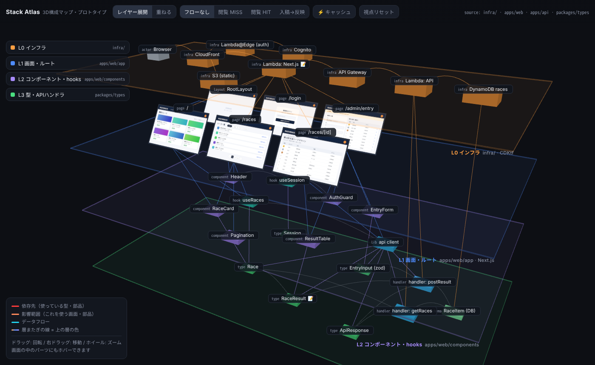
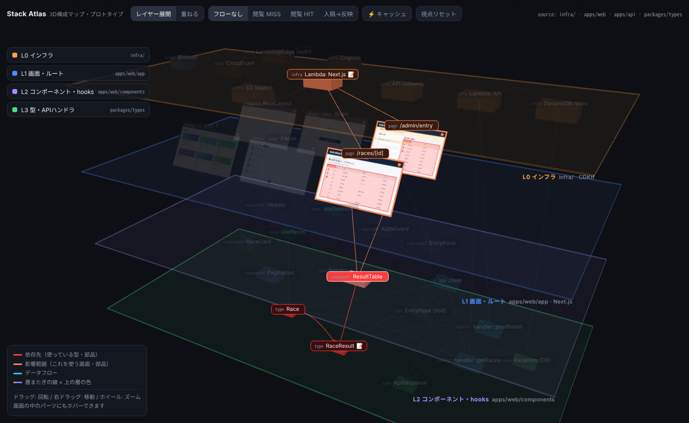
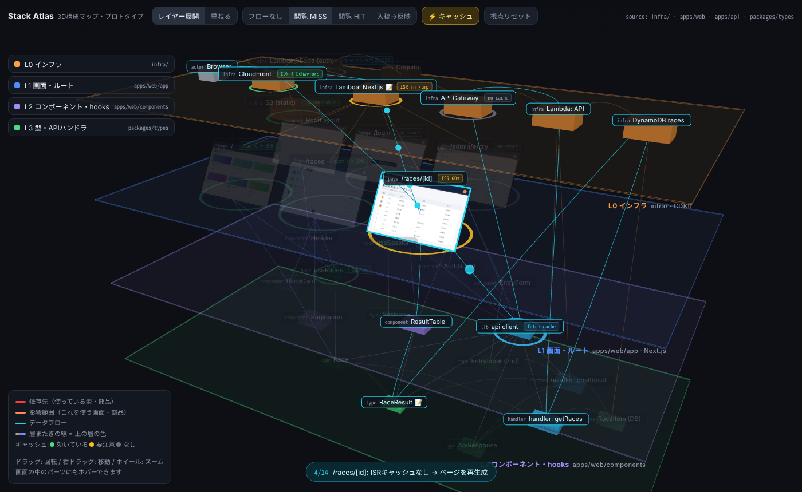

# Stack Atlas

インフラ → 画面 → コンポーネント → 型 を層として 3D に積み、1 画面で依存関係・データフロー・キャッシュを追えるようにするツール（開発初期）。



- 引き継ぎの概要: [HANDOFF.md](HANDOFF.md)
- Claude 向けの作業指示: [CLAUDE.md](CLAUDE.md)
- 動くプロトタイプ: [prototype/](prototype/)
- 仕様: [docs/](docs/)

| | |
|---|---|
|  |  |
| 画面内の ResultTable を指すと、同じ部品を使う画面と型が光る | キャッシュモードと「閲覧 MISS」フロー |

## 開発

Node 22 と pnpm（`corepack enable` で `package.json` の `packageManager` のバージョンが使われる）が必要。

```sh
pnpm install
pnpm dev                                  # ビューアの開発サーバ（packages/viewer、Vite）
pnpm build                                # 全パッケージをビルド。ビューアは packages/viewer/dist/ に静的ファイルが出る
pnpm test                                 # Vitest
pnpm lint && pnpm typecheck               # ESLint と tsc
pnpm validate examples/race-site.graph.json   # graph.json のスキーマ＋参照整合性チェック
```

| パッケージ | 内容 |
|---|---|
| `packages/schema`（`@stack-atlas/schema`） | graph.json の JSON Schema・TypeScript 型・`validateGraph()`・検証 CLI |
| `packages/viewer`（`@stack-atlas/viewer`） | 3D ビューア（Vite + TypeScript + three.js）。現在は雛形のみ |
